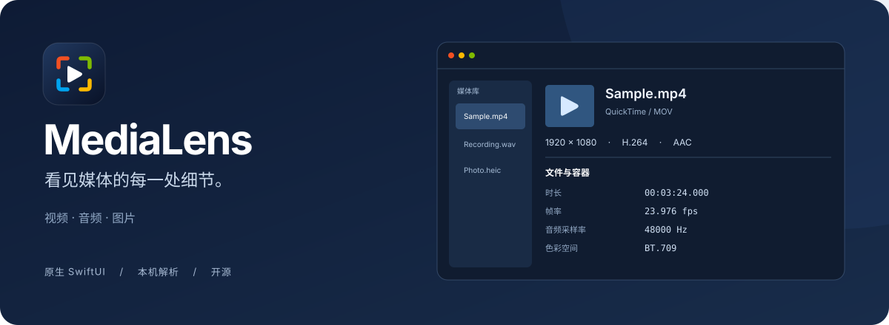

<p align="center">
  
</p>

<p align="center">
  <strong>一个轻巧的原生 macOS 媒体信息查看器。</strong><br>
  拖入文件，看清容器、编码与轨道。无需打开终端，无需另外安装检测引擎。
</p>

<p align="center">
  <a href="#下载">下载</a> ·
  <a href="#开始使用">开始使用</a> ·
  <a href="#功能">功能</a> ·
  <a href="#从源码构建">从源码构建</a> ·
  <a href="CONTRIBUTING.md">参与贡献</a>
</p>

<p align="center"><strong>macOS 14+</strong>　·　<strong>SwiftUI</strong>　·　<strong>本机解析</strong>　·　<strong>MIT</strong></p>

## 下载

<p align="center">
  <a href="https://github.com/AchiDilyar/MediaLens/releases/latest/download/MediaLens.dmg">
    
  </a>
</p>

<p align="center">一份安装包，原生支持 <strong>Intel 与 Apple Silicon</strong> · macOS 14+</p>

[查看所有版本与更新说明](https://github.com/AchiDilyar/MediaLens/releases) · [下载 SHA-256 校验文件](https://github.com/AchiDilyar/MediaLens/releases/latest/download/MediaLens.dmg.sha256)

下载 DMG 后，将 **MediaLens 拖入 Applications** 即可安装。支持 Intel 与 Apple Silicon，一份通用安装包即可使用。

当前默认构建使用 **ad-hoc 签名，尚未完成 Apple 公证**，首次下载可能受到系统拦截。签名与公证流程见 [发布指南](docs/RELEASING.md)。

## 为什么做 MediaLens

有时，你只是想知道一个文件究竟是什么：视频的实际编码、音频的采样率、有没有字幕，或者容器里藏了哪些标签。MediaLens 把这些信息整理成紧凑、可搜索的概览，让检查媒体成为一个随手就能完成的小动作。

它专注于查看信息。当前使用 **FFmpeg 的 ffprobe + Apple 原生框架**，尚未集成 MediaInfo，也不提供转码或媒体编辑。媒体库只保留在当前会话。

## 功能


| 你想做的事 | MediaLens 的方式 |
| --- | --- |
| 检查一批媒体 | 拖入多个文件，后台依次解析，按路径去重 |
| 看清文件内容 | 视频和图片显示系统缩略图；音频显示系统文件图标 |
| 把文件交给其他工具 | 单击预览选中，双击使用默认应用打开，拖出复制原文件 |
| 查找具体参数 | 紧凑概览，搜索属性名、属性值与标签 |
| 从访达直接检查 | 右键 **服务 → 通过MediaLens查看媒体信息** |
| 分享检查结果 | 复制文本报告，导出文本或 JSON |
| 开箱即用 | 应用包内置独立 ffprobe，无需 Homebrew |

支持展示文件提供的容器、大小、时长、码率、视频、音频、字幕、附件、章节及标签。字段覆盖取决于媒体格式和引擎；文件没有提供的信息不会被补写。

头部预览代表**原文件**，拖出不会生成缩略图文件，也不会移动源文件。选中后可用 `⌘C` 复制文件引用、空格快速查看；右键提供打开、复制文件和在访达中显示。缩略图由 macOS Quick Look 提供，不支持预览的格式会回退为系统文件图标。上方横幅为界面示意图。

## 开始使用

1. 下载 `MediaLens.dmg`，打开后把应用拖入 Applications；也可手动放入 `~/Applications`。
2. 打开应用，将视频、音频或图片拖入窗口。
3. 浏览概览；需要分享时，打开工具栏的“更多”菜单导出报告。

你也可以按下面的步骤自行构建。完整应用包内置检测引擎，首次使用无需另外安装 FFmpeg。

### 访达右键入口

安装完整 `.app` 并首次打开后，在访达中选中文件：

**右键 → 服务 → 通过MediaLens查看媒体信息**

支持多文件。未知扩展名也可以尝试检查，不支持的文件会显示错误。若入口未出现，请到系统设置的“键盘 → 键盘快捷键 → 服务”确认已启用。直接 `swift run` 不会注册访达服务。

### 常用操作

| 操作 | 快捷键 / 入口 |
| --- | --- |
| 打开媒体 | `⌘O` / 拖入窗口 |
| 复制文本报告 | `⇧⌘C` |
| 导出文本报告 | `⌘E` |
| 导出 JSON | 更多 → 导出JSON… |
| 重新检查 | `⌘R` |
| 引擎设置 | `⌘,` |

界面始终显示概览，JSON 仅作为导出格式。菜单栏保留 MediaLens 的中文设置与退出入口，常用快捷键仍然可用。

## 从源码构建

需要 Xcode 或 Apple Command Line Tools、macOS 14+、Swift 5.9+。没有第三方 Swift 包依赖。

```sh
# 构建完整 App：首次会下载、校验并编译 FFmpeg 官方源码
bash scripts/build-app.sh
open dist/MediaLens.app

# 生成 Intel + Apple Silicon 通用 DMG 和 SHA-256 校验文件
bash scripts/package-release.sh
```

内置引擎固定为 FFmpeg 8.0.1，由 [构建脚本](scripts/build-engine.sh) 编译为独立 ffprobe，只依赖 macOS 系统库。每个应用包都附带完整对应源码、许可与构建参数，详见 [第三方组件](docs/THIRD-PARTY.md)。首次编译引擎需要联网和数分钟，后续会复用本机架构的缓存。完整 App 与内置引擎都包含 `arm64` 和 `x86_64`；发布产物固定为 `dist/MediaLens.dmg` 与 `dist/MediaLens.dmg.sha256`。DMG 构建额外使用 Python 3.9+ 和隔离的构建工具，首次会下载固定版本依赖，不将这些工具放入 App。

默认完整构建会交叉编译两种架构；只需要本机开发包时：

```sh
APP_ARCHS="$(uname -m)" bash scripts/build-app.sh
```

只调试 Swift 界面时：

```sh
swift run MediaLens
```

源码运行优先查找本机 ffprobe，未找到时使用 AVFoundation / ImageIO 读取基本信息。可选 `brew install ffmpeg`，也可在设置中指定 ffprobe 路径。完整 `.app` 优先使用内置版本；自定义路径可覆盖它。

### 测试与命令行

```sh
swift run MediaLensChecks
bash scripts/smoke-test.sh
bash scripts/check-bundled-engine.sh
bash scripts/check-dmg.sh
```

核心检查无需 XCTest。媒体集成检查需要 `ffmpeg` 和 `python3`，会生成临时素材并清理；内置引擎检查在构建完整 App 后运行，验证系统库依赖、源码许可材料与实际媒体解析。

同一可执行文件也支持输出 JSON：

```sh
dist/MediaLens.app/Contents/MacOS/MediaLens --inspect /absolute/path/to/video.mp4
swift run MediaLens --inspect /absolute/path/to/audio.wav --native
```

## 文件与隐私

应用在本机解析，不上传媒体，也不修改源文件。内置引擎在构建时禁用网络协议；调用时进一步限制为 `file,crypto,data`，并设置 30 秒超时。本地播放列表可能引用其他本地文件。自定义引擎的能力和行为取决于用户选择的程序。

Apple 原生回退只提供系统支持的格式与基础字段。ffprobe 已找到但解析失败时，会直接显示错误，便于保留真实的诊断结果。

## 项目结构

```text
Sources/MediaLens/        SwiftUI 界面、文件预览与应用状态
Sources/MediaLensCore/    媒体模型、解析与格式化
Tests/                   独立核心检查
Assets/AppIcon.png       构建所需的唯一最终图标资源
scripts/                 引擎、图标、构建、DMG 与验证脚本
docs/                    SVG 横幅、开发与发布指南
.github/                 CI、Issue 和 PR 模板
```

欢迎提交问题、改进格式覆盖或完善原生交互。开始前可以阅读 [贡献指南](CONTRIBUTING.md)、[开发指南](docs/DEVELOPMENT.md) 与 [更新记录](CHANGELOG.md)。首次上传和 Release 发布的完整步骤见 [GitHub 上手指南](docs/GITHUB.md)。

CI 会在 Apple Silicon 与 Intel 运行器分别执行原生解析检查；推送 `v*` 标签后，发布流程生成通用 DMG 和 **Release 草稿**，由维护者检查后正式发布。

## 许可与致谢

MediaLens 的 Swift 源码和自绘图标使用 [MIT License](LICENSE)。内置 ffprobe 属于 [FFmpeg](https://ffmpeg.org/)，按 **LGPL 2.1 或后续版本**分发，其许可不由 MIT 覆盖。应用包内保留对应源码、版权与许可材料，参见 [第三方组件](docs/THIRD-PARTY.md) 和 [FFmpeg 分发说明](https://ffmpeg.org/legal.html)。

感谢 FFmpeg 以及 Apple 的 AVFoundation、ImageIO 和 Quick Look，为这个小工具提供可靠的基础。
